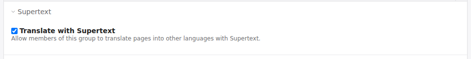
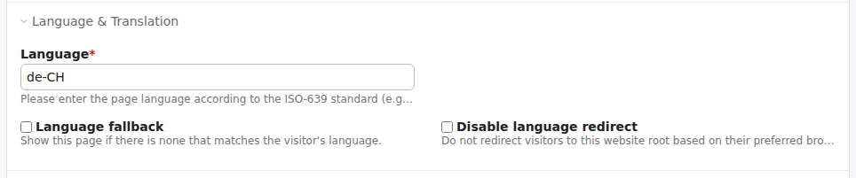
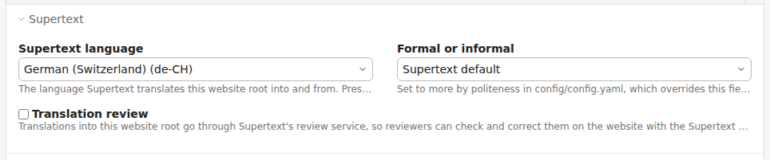

# Installation guide

For administrators who set up a Contao installation. Editors: see the [User guide](USER_GUIDE.md).

## Requirements

| | |
| --- | --- |
| Contao | 5.7 (LTS) or 6.0 |
| PHP | 8.3 or newer (Contao 6 needs 8.4) |
| Database | MySQL 8.0/8.4 or MariaDB 10.11+ (as required by Contao; MySQL 9 is not supported by Contao) |
| Multilingual site | One **website root per language** in the site structure, each with its own *Language* setting (e.g. `en`, `de-CH`, `fr-CH`) |
| Supertext | A Supertext account and an API key with access to AI translation (see [API key](#api-key)) |

The server must reach `https://api.supertext.com` over HTTPS.

Recommended: [terminal42/contao-changelanguage](https://extensions.contao.org/?p=terminal42%2Fcontao-changelanguage) for the language switcher on the website. When it is installed, translated pages are linked to their source automatically, so the switcher works without extra steps. On Contao 6, its current release (3.9) still requires some Symfony 7 packages; install it with `composer require -W terminal42/contao-changelanguage` so Composer may adjust them.

## Install

With the Contao Manager: search for `supertext/contao-supertext-translation` and install it. Then run the database update in the Contao Manager (or *Maintenance → Database update* / `contao:migrate`).

With Composer:

```bash
composer require supertext/contao-supertext-translation
vendor/bin/contao-console contao:migrate
```

Until the package is published on Packagist, add the GitHub repository first:

```bash
composer config repositories.supertext vcs https://github.com/Supertext/Contao-Supertext-Translation
composer require supertext/contao-supertext-translation:dev-main
```

The database update adds a few columns (`supertext_source` on pages, articles and content elements, and the `supertext` permission on users and user groups) and a small table `tl_supertext_state` (see [Version information and the API key check](#version-information-and-the-api-key-check)). No existing data is changed.

## API key

1. No Supertext account yet? Create one at <https://www.supertext.com/person/en/account/signin> (log in or create a Supertext account with your e-mail address).
2. Generate your API key at <https://www.supertext.com/en/integrations/api> (supertext.com → *Integrations* → *API*). This requires the **Admin** role in your Supertext account; otherwise ask your Supertext account admin for a key.

Set the key as an environment variable of the web server, or in the `.env.local` file of your Contao installation (never commit it):

```bash
SUPERTEXT_API_KEY=your-key-here
```

The key works with or without the `Supertext-Auth-Key ` prefix that Supertext shows.

Without a key, the translate screen shows "No Supertext API key is configured" with the two links above, and the *Translate* button is disabled. The bundle also checks the key automatically; administrators see the result at the bottom of the translate screen (see [below](#version-information-and-the-api-key-check)).

## Permissions

Administrators can always translate. For other users:

1. *User groups* (or the user) → **Supertext** → tick **Translate with Supertext**.
2. Make sure the group can edit the target language trees: the website roots of the other languages in *Pagemounts*, the page types in *Allowed page types*, and edit permission on those pages (*Site structure → page → Permissions*).



The *Translate with Supertext* icon only appears for users with the permission, and the translate screen only offers languages whose website root the user may edit.

## Interface languages

The bundle's screens, the permission and its messages are available in English, German, French and Italian. They follow each back-end user's language (user menu → *Profile* → *Back end language*); other languages fall back to English. This is independent of the website languages below.

## Language setup



Each website root's *Language* needs a Supertext language. Choose it in the root's own settings: **Content → Pages → edit the website root (pencil) → section *Supertext***:



- **Supertext language**: a select with all of Supertext's languages, shown as "Name (code)" in your back-end language, e.g. *Deutsch (Schweiz) (de-CH)*. It is used for both directions: when this root is translated into, and when it is the source (then without region: `de-CH` → `de`).
- **Formal or informal**: *Supertext default*, *Formal* (Sie, vous, Lei) or *Informal*. It only appears when the chosen Supertext language offers it (not for English, Swiss German, Romansh, Albanian and Serbian); choosing the Supertext language reloads the form.

The select is **preselected** for every root, so most sites need no setup:

1. the root's language when it is itself a Supertext code (apart from upper/lower case and `_`/`-`): `de-CH`, `fr-CH`, `it-CH`, `es`, `nl`;
2. else the usual Supertext language for it:

   | Root language | Preselected |
   | --- | --- |
   | `de`, `en`, `fr`, `it`, `pt` | `de-DE`, `en-US`, `fr-FR`, `it-IT`, `pt-PT` |
   | `zh`, `zh-CN`, `zh-SG` / `zh-TW`, `zh-HK`, `zh-MO` | `zh-Hans` / `zh-Hant` |
   | `sr`, `sr-Latn-RS` | `sr-Latn` |
   | a region of a language Supertext offers without one | that language: `es-ES` → `es`, `nl-NL` → `nl`, `nb-NO` → `nb` |

3. else **"— choose —"**: Supertext has no usual language for it, e.g. `de-LI`, `en-IE`, `fr-BE`, `gsw` or `sr-RS`. Choose one before translating; until then the translate screen marks the language *no Supertext language yet* (it can't be selected), and nothing is sent for it.

A root that is never saved with another choice keeps following its *Language*: only a Supertext language that differs from the preselected one is stored. The select only accepts Supertext's codes.

Supertext's target codes (from its `features` list, October 2026):

| Language | Supertext codes |
| --- | --- |
| German, English, French, Italian, Portuguese | `de-DE`, `de-CH`, `de-AT`, `en-US`, `en-GB`, `fr-FR`, `fr-CH`, `it-IT`, `it-CH`, `pt-PT`, `pt-BR` |
| Chinese, Serbian | `zh-Hans`, `zh-Hant`, `sr-Latn`, `sr-Cyrl` |
| Swiss German | `gsw-u-sd-chzh` (Zurich), `gsw-u-sd-chbe` (Bern) |
| All others, without region | `bg`, `cs`, `da`, `el`, `es`, `fi`, `hr`, `hu`, `ja`, `ko`, `nb`, `nl`, `pl`, `rm`, `ru`, `sk`, `sl`, `sq`, `sv`, `tr` |

**Override for automated setups:** `language_map` and `politeness` in `config/config.yaml` win over the roots' settings (clear the cache after changing them). The root's settings then show *Set to … by language_map in config/config.yaml* under the field. Earlier versions only had this configuration: it keeps working as it is, nothing needs to be migrated.

```yaml
supertext_translation:
    language_map:
        de-LI: de-CH        # Contao language => Supertext code (one of the codes above)
        en: en-GB           # used for both directions: as the source, en-GB is sent as en
    politeness:
        de-CH: more         # formal ("Sie"); "less" = informal
```

The translate screen shows, next to each language, the Supertext code it is sent as when it differs from the root's language.

Target languages are the other website roots **of the same domain** (same *Domain name* setting) with a different language.

## All settings

`config/config.yaml` of the Contao installation:

| Setting | Default | Description |
| --- | --- | --- |
| `api_key` | `%env(SUPERTEXT_API_KEY)%` | Supertext API key. |
| `environment` | `live` | `live`, `staging` or `testing` Supertext API. May be an env variable. |
| `api_url` | `''` | Explicit API base URL (e.g. a proxy); overrides `environment`. |
| `language_map` | `{}` | Optional: Contao language → Supertext code (e.g. `de: de-CH`), overrides the website roots' *Supertext language* (see [Language setup](#language-setup)). For the source, the mapped code's language is sent (`de-CH` → `de`). |
| `politeness` | `{}` | Optional: Contao language → `default`, `more` (formal) or `less` (informal), overrides the roots' *Formal or informal*. Sent as it is, also for a language without formal/informal (the translate screen warns). |

In each website root (Content → Pages → edit the root → *Supertext*):

| Field | Default | Description |
| --- | --- | --- |
| *Supertext language* | preselected (see [Language setup](#language-setup)) | Supertext code for this root's language, both directions. Column `tl_page.supertext_language` (`''` = the preselected one). |
| *Formal or informal* | *Supertext default* | Only shown where the Supertext language offers it. Column `tl_page.supertext_politeness`. |
| `version_reports` | `true` | *Send version information to Supertext* (see [below](#version-information-and-the-api-key-check)). The environment variable `SUPERTEXT_VERSION_REPORTS` (`0`, `false`, `off`, `no` or `1`, `true`, `on`, `yes`) wins over this setting. |
| `poll_interval` | `2` | Seconds between status checks while Supertext translates. |
| `timeout` | `180` | Maximum seconds to wait for one page and language. |
| `fields` | see below | Which fields are translated, per table. |

### Translated fields

| Table | Fields (type) |
| --- | --- |
| Pages (`tl_page`) | `title`, `pageTitle`, `description` (text) |
| Articles (`tl_article`) | `title` (text), `teaser` (html) |
| Content elements (`tl_content`) | `headline`, `sectionHeadline` (inputUnit), `text`, `caption`, `mooHeadline` (html), `alt`, `imageTitle`, `summary`, `titleText`, `linkTitle`, `playerTitle`, `playerCaption` (text), `listitems` (list), `tableitems` (table) |

Add fields of your own content elements or switch defaults off:

```yaml
supertext_translation:
    fields:
        tl_content:
            myTeaserText: html     # text | html | inputUnit | list | table
            caption: false         # don't translate image captions
```

Not translated: page aliases (a new alias is generated from the translated title), URLs, images and other files, code and HTML elements, form fields, news, events and FAQ (see the roadmap in the [Developer guide](DEVELOPER.md)).

## Version information and the API key check

**Send version information to Supertext** (`version_reports`, on by default) sends the site URL and the versions of this extension, Contao and the runtime to Supertext after an update and when the API key changes, so Supertext support can see which version you run. A report contains exactly: the site URL (the address the back end is used on), the extension's name and version, the Contao and PHP versions, the Supertext SDK version, whether a key is set, the result of the API key check below (status, time, HTTP status, Supertext's error code) and the address of the ping endpoint. **No content, no API key and no personal data are sent.** Reports go from the Contao server after the back-end page has been sent, never from the browser; a report that fails is not retried for an hour and never slows down or breaks a translation.

To turn it off, set `version_reports: false` in `config/config.yaml` (then clear the cache), or the environment variable `SUPERTEXT_VERSION_REPORTS=0`. Nothing is sent at all then, and the ping endpoint answers 404.

**The API key check** runs whether or not version information is sent: when the translate screen is opened with a key that hasn't been checked yet (the key is compared by a SHA-256 fingerprint kept in the database, never the key itself), and when Supertext rejects the key during a translation. It's Supertext's cost-free `features` call; nothing is translated or billed. The check runs after the page has been sent, so the result appears the next time the screen is opened. Administrators see the latest result with its time at the bottom of the translate screen: *the connection to Supertext works*, *Supertext rejected the API key* (with the links to create an account and generate a key), *no API key is set*, *Supertext can't be reached* or *Supertext answered with an error*. The same box shows whether version information is sent.

**The ping endpoint** `GET <site>/_supertext/ping?challenge=…` is public (no login, no session, not cached) and answers only `{"ok":true,"plugin":"Contao-Supertext-Translation","challenge":"…"}`, so Supertext can see that the site is reachable from the internet. It returns nothing else: no versions, no settings, no data. If a firewall or a front-end proxy blocks `/_supertext/`, translations still work; only this check fails.

The bundle keeps this state (what was reported last, the latest key check) as one row in the table `tl_supertext_state`, created by the database update.

## Hosting notes

A translation runs while the editor waits (a few seconds per page; a whole site can take minutes). PHP's `max_execution_time` is lifted for the request; make sure your web server and proxies allow long requests (e.g. Apache `Timeout`, nginx `proxy_read_timeout` / `fastcgi_read_timeout` ≥ 300 s) when translating whole sites.

## Update

Contao Manager: update the package, then run the database update. Composer: `composer update supertext/contao-supertext-translation` and `contao:migrate`. See [CHANGELOG.md](../CHANGELOG.md).

## Uninstall

Remove the package (Contao Manager or `composer remove supertext/contao-supertext-translation`) and run the database update; it offers to drop the added columns and the table `tl_supertext_state`. Translated pages stay as they are.

## Troubleshooting

| Symptom | Cause / fix |
| --- | --- |
| No translate icon in the site structure | The user lacks the Supertext permission (user group → Supertext), or the database update wasn't run. |
| "There is no other language of this website you may edit" | No other website root with a different language and the same domain, or the user can't edit those roots (pagemounts, page permissions). |
| "No Supertext API key is configured" | Set `SUPERTEXT_API_KEY` and clear the cache. No key yet: see [API key](#api-key). |
| "Authentication failure" | Wrong key, or a key for another environment (`live` vs `staging`). Generate a new key at <https://www.supertext.com/en/integrations/api> (Admin role required). |
| "Too many requests to Supertext" | Supertext's per-second rate limit. Each request is retried up to 4 times automatically; if it still appears, translate fewer languages at once and try again. |
| "Your Supertext translation limit is exceeded" | The Supertext subscription quota is used up. |
| *no Supertext language yet* next to a language / "The language … has no Supertext language yet" | Supertext has no usual language for the root's language (e.g. `de-LI`, `en-IE`): choose its *Supertext language* in the root's settings (see [Language setup](#language-setup)). |
| The *Supertext section* is missing in a website root | Run the database update (it adds `supertext_language` and `supertext_politeness` to `tl_page`); non-admin users also need the two fields allowed in their group's *Allowed fields* of pages. |
| "Supertext does not support this language pair" | A `language_map` code Supertext doesn't offer (e.g. `es-ES` instead of `es`), or source and target are the same language; fix the entry or the roots' *Supertext language*. The log has the codes that were sent. |
| "Supertext offers no formal or informal tone for this language" | `politeness` in `config/config.yaml` sets `more`/`less` for a language without it (English, Swiss German, Romansh, Albanian, Serbian); remove that entry. (The root's *Formal or informal* is never sent for such a language.) |
| "Supertext rejected the API key" in the API key check | The key is wrong or revoked. Check that the whole key was copied into `SUPERTEXT_API_KEY`, or generate a new one at <https://www.supertext.com/en/integrations/api> (Admin role required). No Supertext account yet? Create one at <https://www.supertext.com/person/en/account/signin>. Clear the cache and open the translate screen again. |
| "The API key couldn't be checked because Supertext can't be reached" | The Contao server can't reach `api.supertext.com` (firewall, proxy, DNS). Translations need the same connection. |
| "Not checked yet" in the API key check | The check runs after the page was sent; reload the screen. If it stays, run the database update (the table `tl_supertext_state` is missing). |
| "Timed out waiting…" | Very long page or slow service: raise `timeout`, and the web server timeouts. |
| "Insert tags were moved to the end…" | The translation lost the position of an insert tag; it was appended so nothing breaks. Check the text. |
| Language switcher doesn't show a translation | The translated page is still unpublished, or changelanguage isn't installed. |

Errors are also written to the Contao system log.
