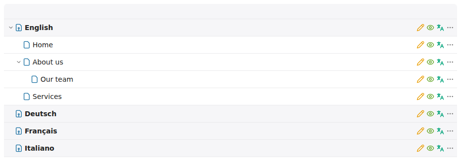
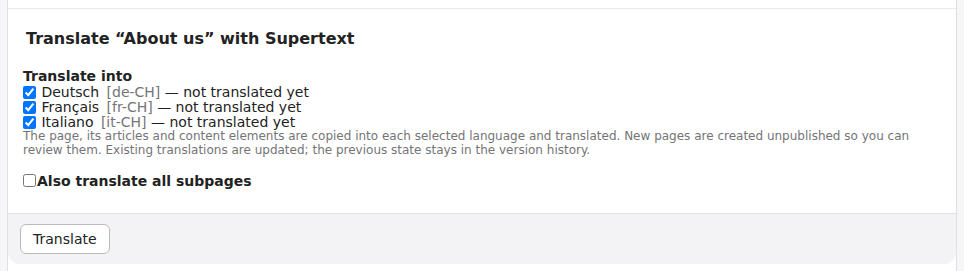
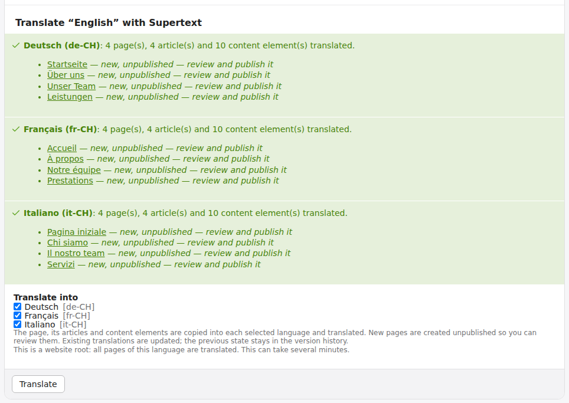
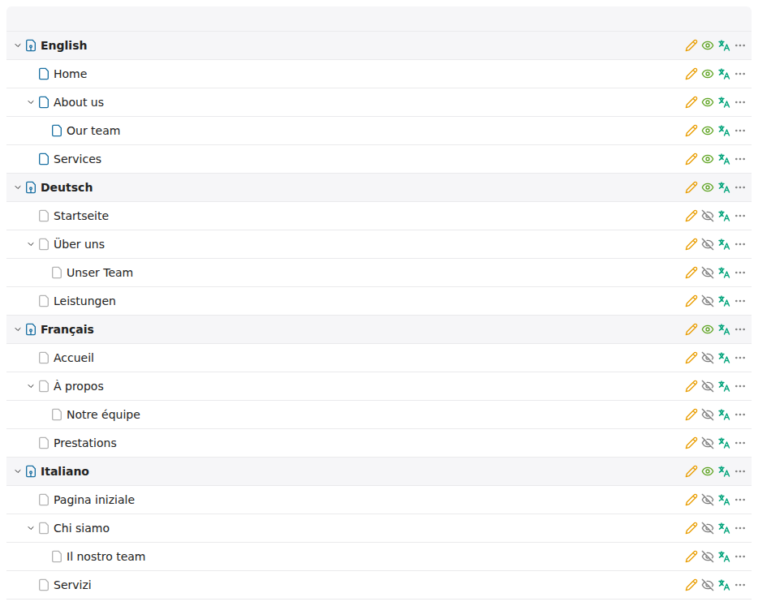
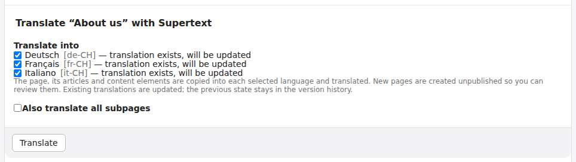
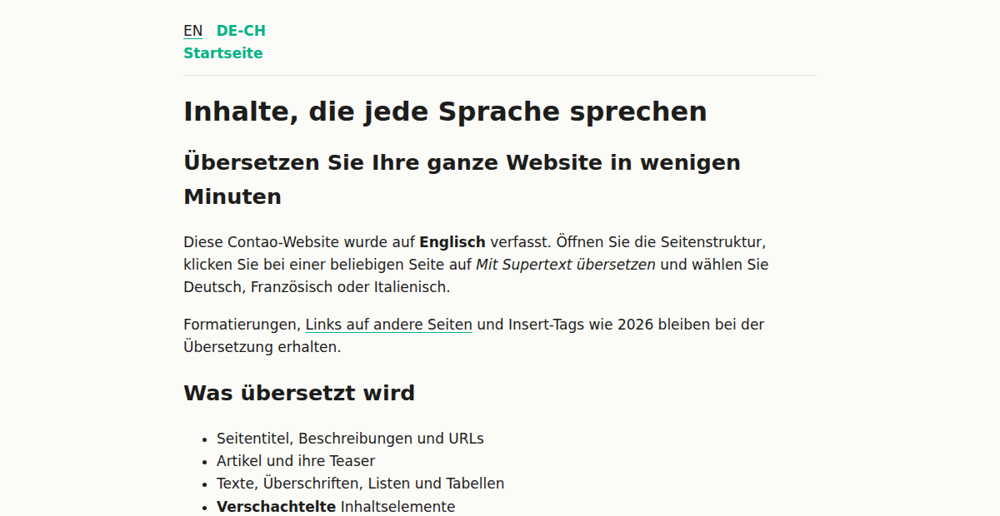

# User guide

For editors working in the Contao back end.

In Contao, each language of a website has its own page tree: one website root per language (e.g. *English*, *Deutsch*, *Français*). Supertext copies a page with its articles and content elements from one language into the others and translates the texts on the way.

## Translate a page

1. Open **Content → Pages** (site structure).
2. Click the **translate icon** (two letters, green) on the page you want to translate.

   

3. Choose the languages to translate **into**. "Not translated yet" means a new page will be created. A language marked *no Supertext language yet* can't be selected until your administrator chooses its Supertext language (in the website root's settings, section *Supertext*).
4. If the page has subpages, tick **Also translate all subpages** to translate the whole branch.
5. Click **Translate** and wait. One page takes a few seconds; keep the window open.

   

The result lists every language with the translated pages. Click a page to open its articles.

**Translate a whole website:** click the translate icon on the website root (e.g. *English*). All pages of that language are translated. This can take several minutes.

The new pages appear in each language's tree, unpublished (crossed-out eye):

**Translating again:** languages that already have a translation of the page show "translation exists, will be updated". Translating updates those pages in place (see below).

## Translate with a file (XLIFF or HTML)

Instead of translating with Supertext's API, you can download a page's texts as a file, have them translated elsewhere (a translator, a translation tool such as Trados, memoQ or Phrase, or Supertext's web app) and import the translated file again. The translations are written exactly like a translation with Supertext (see *Review and publish*).

**Export for translation:** open the translate screen of the page (translate icon) and scroll to **Export for translation**.

1. Choose the **File format**:
   - **XLIFF 1.2 (for translation tools)**: the better choice for translators and translation tools; formatting, links and insert tags appear as protected tags. One file can hold several languages.
   - **HTML (one language per file)**: for Supertext's web app or anyone who translates HTML. Choose exactly one language.
2. Tick the **target languages** and click **Download file**. The file is called e.g. `contao-12-fr-CH.xlf` (page ID and language; `contao-12.xlf` for several languages).

The file holds the page, its articles and content elements (not its subpages: export them one by one). A page without texts gives *Nothing to translate.* A website root has no texts of its own.

**Send it for translation.** Translators must keep the file's structure: in an HTML file the head (the `supertext:` meta tags) and the `data-st-id` attributes must stay as they are. An HTML file can't mark a text as untranslated: imported unchanged, it writes the source text into the translation.

**Import translation:** on the translate screen of the page (any page of the website works; the file says which page and language it belongs to), under **Import translation**, choose the **Translated file (XLIFF or HTML)** and click **Import translation**. Files up to 10 MB.

By default, texts whose source was edited after the export are skipped, so an old translation doesn't replace a newer text. Tick **Also import texts whose source changed since the export** to import them anyway.

The summary shows, per page and language:

| Line | Meaning |
| --- | --- |
| *Imported: n* | Texts written into the translation. |
| *Skipped, source changed since the export: n* | The source text was edited after the export; tick the option above to import them anyway, or export again. |
| *Not translated in the file: n* | The file has no translation for these texts (XLIFF). |
| *Formatting changed, not imported: n* | The translation broke or added formatting (tags); fix it in the file or translate these texts again. |
| *Not in the file: n* | Texts added since the export; translate them with Supertext or export again. |

Texts that weren't imported keep their current translation (a new page gets the source text for them, unpublished). Errors: *This file isn't a valid XLIFF or HTML translation file*, *This file wasn't exported by the Supertext extension, or its header was removed*, *The file is too large (at most 10 MB)*, *This file belongs to another system (…)* (exported by another Supertext plugin), *The page this file was exported from no longer exists*, *The site has no language …* (its website root was removed or changed its language), *You may not edit the language … of this website*.

## Review and publish

- **New pages are created unpublished** (grey, crossed-out eye in the site structure). Check them, adjust if needed, then publish them like any other page: open the page settings (pencil), tick **Publish page** and save.
- **Existing translations are updated in place.** The previous version stays in the version history (*Restore* / version list of the record), so you can go back.
- If the translated page's parent doesn't exist in the target language yet, Supertext translates the parent too, so the page tree stays the same in every language.
- With the language switcher installed, translated pages are linked to their original: visitors can switch languages on the page.

## What is translated

- Page title, title tag and description (the page alias is generated from the translated title)
- Article titles and teasers
- Text, headlines, lists, tables, image texts (alt text, title, caption), link texts and video captions
- Content elements inside element groups and other nested elements
- Bold, italic, links and insert tags such as `{{link_url::12}}` are kept in place

## What is not translated

- URLs, images and files, code and HTML elements, forms
- News, events and FAQ (planned)
- Settings that are the same in every language (layout, CSS classes, …): these are copied from the source

## Things to know

- **Translating again overwrites manual changes** to the translated texts of that page. Make edits in the source language and translate again, or edit only after the last translation.
- Articles and elements you **add by hand** in a translated page are never touched.
- Articles and elements **deleted in the source** are hidden (not deleted) in the translations.
- Translate in one direction (e.g. always from English). Translating a translated page back would translate from that language.

## Messages

The translate screen and its messages appear in your back-end language (English, German, French or Italian; set in your profile). The table lists the English wording.

| Message | Meaning |
| --- | --- |
| *new, unpublished — review and publish it* | A new page was created; publish it when it's ready. |
| *… element(s) no longer in the source were hidden* | Elements removed in the source were hidden in this language. |
| *… text(s) came back empty from Supertext and kept the source text* | Check those texts in the translated page. |
| *No Supertext API key is configured* | Ask your administrator; the message links to the Supertext account signup and API key pages for them. |
| *There is no other language of this website you may edit* | Ask your administrator to create the language roots or give you access. |
| *Authentication failure* / *limit is exceeded* | Supertext account problem; ask your administrator. |
| *no Supertext language yet* (next to a language) / *The language … has no Supertext language yet* | Supertext has no usual language for the website root's language (e.g. German (Liechtenstein)). Ask your administrator to choose its *Supertext language* in the website root's settings; the other languages are translated. |
| *Supertext does not support this language pair* | The language of a website root isn't one Supertext translates into (or from). Ask your administrator to check the language mapping. |
| *Supertext offers no formal or informal tone for this language* | The tone setting for that language isn't available; ask your administrator to set it to the default. |
| *Timed out waiting…* | Try again, or translate fewer pages at once. |
| *The parent of page … has no translation* | Translate the parent page into that language first (or tick *Also translate all subpages* on the parent). |

If you don't see the translate icon, you don't have the Supertext permission. Ask your administrator.
